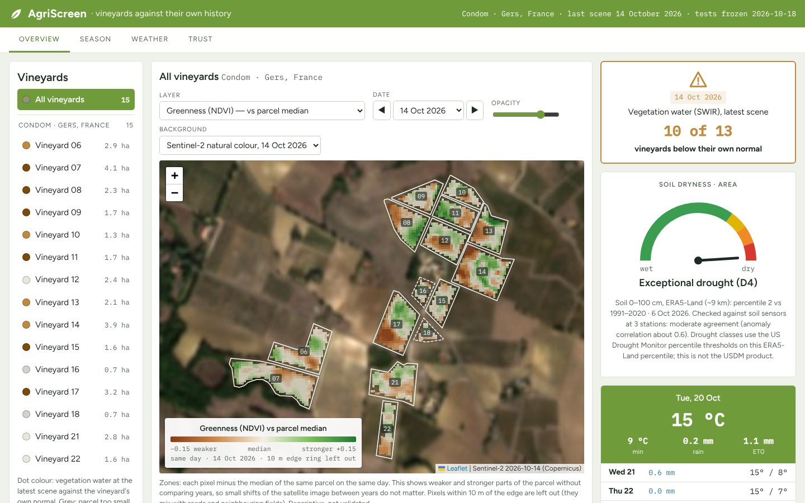

# AgriScreen: vineyards against their own history, from open Copernicus data

[](https://colab.research.google.com/github/geoworldlook/agriscreen/blob/main/notebooks/AgriScreen_Monitor.ipynb)


AgriScreen tells a winegrower near Condom (Gers, south-west France) whether a vineyard parcel is **unusual right now
compared with its own history**, and how far that answer can be trusted. It covers 15 vineyards (0.7–4.1 ha) and
uses only open data: Copernicus Sentinel-2, ERA5-Land and the CLMS Soil Water Index. It gives no irrigation or
treatment advice and does not diagnose vine water stress.



*Panel with the Sentinel-2 background (contains modified Copernicus Sentinel data 2026). The interactive version is
[`docs/showcase/agriscreen_panel.html`](docs/showcase/agriscreen_panel.html); the story with results is
[`notebooks/AgriScreen_story.ipynb`](notebooks/AgriScreen_story.ipynb).*

## What the panel shows

- **Map** on a satellite photo, with a semi-transparent layer:
  10 m pixels inside each vineyard (NDVI, NDRE, NDMI);
  zones (each pixel minus the median of the same parcel on the same day);
  or the whole parcel against the same parcel in the previous five years (z-score, same time of year, same orbit).
- **Card for each vineyard:**
  (1) soil in the area — dry / near normal / wet (ERA5-Land 0–100 cm percentile vs 1991–2020);
  (2) the parcel's vegetation water index (SWIR) below / within / above its own normal, and how many vineyards
  nearby are in the same state;
  (3) whether area vegetation follows soil water — shown only if a pre-registered test confirms it (so far it has not).
- **Statistics, season curve, weather** (7-day forecast, frost and heat) and a **“How far to trust it”** table where
  every line says what it was checked against and what kind of check it was.

## How far to trust it

All tests below were written down and hashed (SHA-256) before any number was computed, and run on data frozen on
2026-10-18 (419 Sentinel-2 scenes, 2016–2026). Protocols and results: [`docs/evidence/`](docs/evidence/)
(summary: [`karta_wynikow.md`](docs/evidence/karta_wynikow.md)).

| What | Result | Status |
|---|---|---|
| Soil moisture 0–100 cm (ERA5-Land) vs in situ sensors at 3 stations | anomaly correlation 0.57 Condom (ISMN), 0.57 Auradé, 0.68 Lusignan (ICOS, 35-day anomalies); same dry/normal/wet class on 55–65% of days | checked (no pass threshold) |
| Soil water index (ASCAT satellite) | 0.57 / 0.52 / 0.53 | checked |
| 30-day rainfall (ERA5-Land) vs rain gauge | R 0.90 | checked |
| Parcel index: noise between close scenes | smallest clear change (MDC95) 1.0 z same orbit, 1.1 z different orbits | descriptive |
| Parcel index: share of scenes “below its own normal” (expected 16%) | 28% [4; 52]; from 1% (2021) to 76% (2022); 14% [0; 30] with near-normal soil | descriptive — no gross miscalibration, weak test |
| Area vegetation follows soil water of the previous 30 days | ρ 0.55 [−0.02; 1.00] (criterion: lower bound > 0) | **not confirmed** — sentence 3 hidden |
| 4-band model (red, red-edge, NIR, SWIR) instead of the simple index | Δρ −0.01 [−0.18; 0.16] | **not adopted** |
| Vine water stress | no measurements inside the vineyards | not validated |

**Negative results, reported as such:**
- **Places inside a parcel against their own history did not pass.** “Zones weaker than usual” (W3c) would light up
  about 15% of the parcel area on ordinary days (limit 5%). “Lowest in five years” for 30 m squares (W3d) could not
  be checked for calibration with only four years of normal-soil months. Neither is drawn on the map; both will be
  re-tested after the 2027 season with the same rules.
- Vegetation and soil agree mostly **between years** (ρ of seasonal means 0.64) but not **within a season** (0.06).
- An earlier experiment used a normal that included later years; with the causal normal the agreement with the
  sensor on the same days fell from 0.57 to 0.44 (several things changed at once, so not all of it is leakage).
- Super-resolution to 2.5 m (SEN2SR) gave the same validation result as 10 m and was removed in 1.0.

Before 1.0 an independent recomputation from the output files checked every number above
([`docs/STAN_I_PLAN.md`](docs/STAN_I_PLAN.md) §4).

## Code

```text
agriscreen/                 Python package (docs/ARCHITEKTURA.md)
├── config.py               all settings; method values come from the registered protocols
├── runtime.py              Colab / local setup, CSV registry, run_task
├── ingest.py               Sentinel-2 L2A (Earth Engine), ERA5-Land, CLMS SWI (Copernicus Data Space)
├── metrics.py              indices, parcel statistics with a 20 m inner strip, anomalies, SPI
├── parcel.py               15 vineyards vs their own history; pre-registered tests T1–T3, 4-band model
├── stations.py             ISMN Condom sensor, quality-control rules
├── reference.py            ICOS stations and the shared soil-layer validation
├── weather.py              Météo-France: ERA5-Land validation, frost and heat
├── card.py                 card sentences
├── panel.py                the product: panel.html + panel_data.json
├── pipeline.py             tasks in order, run_all
├── experiments/            W3c zones, W3d months (off by default)
└── selftest.py             offline end-to-end test on synthetic data
notebooks/                  AgriScreen_Monitor (Colab), AgriScreen_story (blog), and their generators
docs/                       status, architecture, protocols and results (in Polish), showcase files
data/                       vineyard polygons, ISMN SMOSMANIA sensors, RPG crop register
```

## How to run

**In Colab (full pipeline):** open [`notebooks/AgriScreen_Monitor.ipynb`](notebooks/AgriScreen_Monitor.ipynb) from
GitHub (badge above) and choose *Run all*. It mounts Google Drive, updates the code, installs packages, initialises
Earth Engine and runs `ingest → parcel statistics → soil → tests → anomalies → validation → weather → panel →
summary`. Keys are read only from a folder on Drive. Outputs: `data/05_Final_Outputs/agriwatch/` and the registry
`data/registry/gwl_*.csv`.

**Locally, without network or keys:**

```bash
pip install -r requirements.txt
python -m agriscreen.selftest --out /tmp/agriscreen_selftest   # synthetic data, all tasks, a few minutes
ruff check agriscreen
```

**In a script:**

```python
from agriscreen.runtime import setup_runtime
from agriscreen.config import make_config
from agriscreen.pipeline import run_all
rt = setup_runtime(PROJECT_DIR)
run_all(rt, make_config(PROJECT_DIR), ingest_data=True, experiments=False)
```

## Data and attribution

Copernicus Sentinel-2 L2A (ESA), ERA5-Land (Copernicus Climate Change Service), CLMS Soil Water Index (Copernicus
Land Monitoring Service); in situ: ISMN SMOSMANIA (Météo-France / ISMN), ICOS stations FR-Aur and FR-Lus (CC BY 4.0);
rain gauges Météo-France; crop register RPG (IGN); 7-day forecast Open-Meteo; background imagery in the browser
Esri World Imagery; map library Leaflet.

## License

[MIT](LICENSE). Documentation in [`docs/`](docs/) is in Polish; the Polish README from before 1.0 is in
[`docs/archive/`](docs/archive/). Changes: [`CHANGELOG.md`](CHANGELOG.md).
